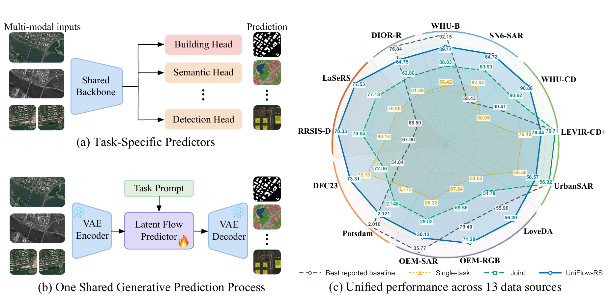
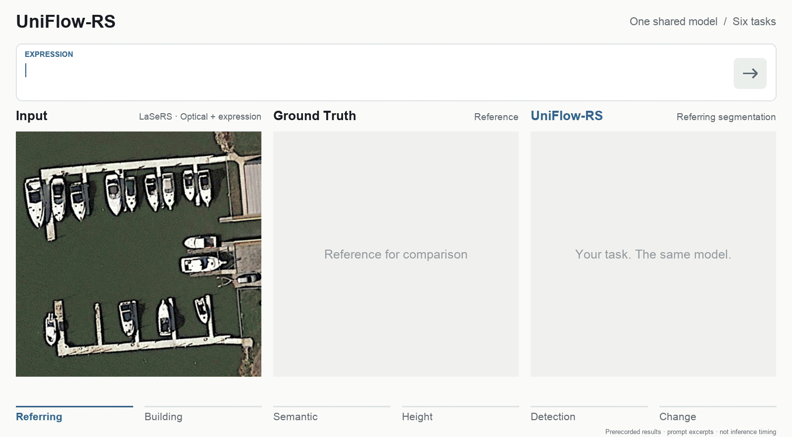

<h1 align="center">UniFlow-RS</h1>

<h3 align="center">Unified Generative Prediction<br>for Heterogeneous Remote-Sensing Tasks</h3>

<p align="center">
  <a href="https://openreview.net/profile?id=~Jianlong_He1">Jianlong He</a><sup>1</sup>,
  <a href="https://openreview.net/profile?id=~Liang_Liao3">Liang Liao</a><sup>2</sup>,
  <a href="https://openreview.net/profile?id=~Jing_Xiao6">Jing Xiao</a><sup>1</sup>,
  <a href="https://openreview.net/profile?id=~Chaofeng_Chen1">Chaofeng Chen</a><sup>1</sup>,
  <a href="https://openreview.net/profile?id=~Gui-Song_Xia3">Gui-Song Xia</a><sup>1</sup>
</p>

<p align="center">
  <sup>1</sup>School of Artificial Intelligence, Wuhan University<br>
  <sup>2</sup>Hangzhou Institute of Technology, Xidian University
</p>

<p align="center">
  <a href="https://arxiv.org/abs/2611.14281"><b>arXiv</b></a> ·
  <a href="https://elaxegan.github.io/uniflow-rs/"><b>Project Page</b></a>
</p>

<p align="center">
  
</p>

**UniFlow-RS** formulates heterogeneous remote sensing tasks as a shared
generative prediction process. Binary masks, semantic maps, height fields,
referring masks, and rotated-object targets are represented in a common
structured visual space, predicted through one shared model, and recovered
with task-dependent deterministic decoders.

<p align="center">
  
</p>

## Requirements

- Python 3.10
- PyTorch with CUDA and BF16 support
- A CUDA-capable GPU; single-GPU and multi-GPU evaluation are supported

## Installation

Run the following commands from the repository root:

```bash
python3.10 -m venv .venv
source .venv/bin/activate
python -m pip install --upgrade pip
python -m pip install -r requirements.txt
```

Direct dependencies are pinned to the observed evaluation environment
(Python 3.10.8, PyTorch 2.8.0, torchvision 0.23.0, CUDA 12.8 build).
Use a compatible NVIDIA driver. See [reproducibility notes](docs/REPRODUCIBILITY.md)
for evaluation settings and commands.

## Models

Download the **[UniFlow-RS checkpoint (Hugging Face)](https://huggingface.co/elaxEgan/UniFlow-RS)**
and save `uniflow_rs.pt` under `checkpoints/`.

Place the base transformer, autoencoder, text encoder, and UniFlow-RS adapter
in the following locations:

```text
pretrained/
├── flux2-klein-base-4b/
│   ├── flux-2-klein-base-4b.safetensors
│   └── ae.safetensors
└── qwen3-4b-fp8/
    └── ... text encoder model files ...
checkpoints/
└── uniflow_rs.pt
```

<details>
<summary><b>Download the upstream base-model assets</b></summary>

These commands download third-party assets, not the UniFlow-RS adapter.
Upstream access requirements and asset licenses apply.

```bash
hf download black-forest-labs/FLUX.2-klein-base-4B \
  flux-2-klein-base-4b.safetensors \
  --local-dir pretrained/flux2-klein-base-4b
hf download black-forest-labs/FLUX.2-dev ae.safetensors \
  --local-dir pretrained/flux2-klein-base-4b
hf download Qwen/Qwen3-4B-FP8 \
  --local-dir pretrained/qwen3-4b-fp8
```

</details>

## Inference

Follow [docs/DATASETS.md](docs/DATASETS.md) and place prepared datasets below
`data/`. Check the dataset paths in `configs/uniflow_rs_512_2step_eval.yaml`;
keep the model, prompt, palette, preprocessing, and inference settings fixed
when comparing results.

The evaluation defaults use **two flow steps**, **BF16**, and **seed 12345**.
Batch size and other runtime settings are defined in
`configs/uniflow_rs_512_2step_eval.yaml`. Evaluation defaults to a single GPU.
For multi-GPU evaluation, explicitly set `NUM_PROCESSES` to the desired GPU
count (for example, `NUM_PROCESSES=2`).

### One benchmark

```bash
METRICS_ONLY=1 \
  bash scripts/eval.sh whu_cd checkpoints/uniflow_rs.pt outputs/whu_cd
```

<details>
<summary><b>All supported dataset keys</b></summary>

```text
whu_building       spacenet6           whu_cd
levir_cd_plus      urbansar_floods     loveda
openearthmap_rgb   openearthmap_sar    potsdam
dfc23_track2       rrsisd              lasers
dior_r
```

</details>

### All thirteen benchmarks

Metrics only:

```bash
METRICS_ONLY=1 \
  bash scripts/eval.sh all checkpoints/uniflow_rs.pt outputs/all_benchmarks
```

Metrics, predictions, and comparison panels:

```bash
bash scripts/eval.sh all checkpoints/uniflow_rs.pt outputs/all_benchmarks
```

Leave `METRICS_ONLY` unset to export images. Keep the process count and batch
size fixed when checking numerical reproducibility; identical results across
different settings have not been established.

Results include `metrics_summary.json`, `per_dataset_metrics.json`,
per-dataset JSON files, and task-specific `metrics.json` files.
Visualization-enabled runs also save inputs, ground truth, probabilities,
predictions, and comparison panels as applicable to each task.

## Code structure

Start with [`uniflow_rs/model.py`](uniflow_rs/model.py): `UniFlowRS` assembles
the frozen VAE, shared FLUX.2 + LoRA transformer, and text conditions. Evaluation
uses this facade for checkpoint loading and prediction, while retaining the
original component names and computations.

```text
Image(s) + prompt
  -> visual/text encoding and task-dependent source state
  -> shared FLUX.2 + LoRA flow integration
  -> VAE decoding into a structured visual target
  -> deterministic task recovery
```

Dataset preprocessing lives in `uniflow_rs/data/`; evaluation, task recovery,
and metrics are coordinated by `uniflow_rs/evaluation/` and
`uniflow_rs/task_runtime.py`. Training starts in `uniflow_rs/training/engine.py`;
TMAS is implemented in `uniflow_rs/training/tmas.py` and is not an extra inference
network layer.

## Citation

```bibtex
@misc{he2026uniflowrs,
  title={UniFlow-RS: Unified Generative Prediction for
         Heterogeneous Remote-Sensing Tasks},
  author={He, Jianlong and Liao, Liang and Xiao, Jing and
          Chen, Chaofeng and Xia, Gui-Song},
  year={2026},
  eprint={2611.14281},
  archivePrefix={arXiv},
  primaryClass={cs.CV},
  url={https://arxiv.org/abs/2611.14281}
}
```

## License

The source release is provided under [Apache-2.0](LICENSE). The official
FLUX.2 implementation and pinned revision are documented in [NOTICE](NOTICE)
and the [upstream notice](uniflow_rs/_compat/vendor/flux2/NOTICE.md).
Model weights, Qwen assets, and datasets remain subject to their respective
upstream terms; they are not redistributed in this source package.
